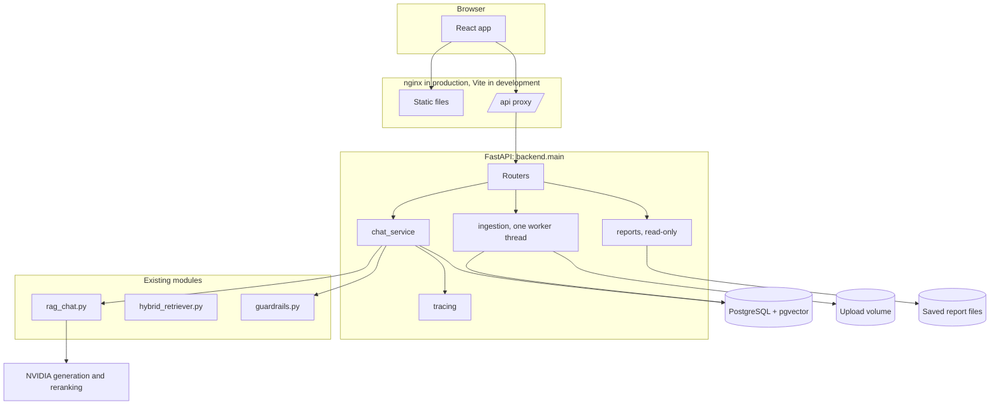
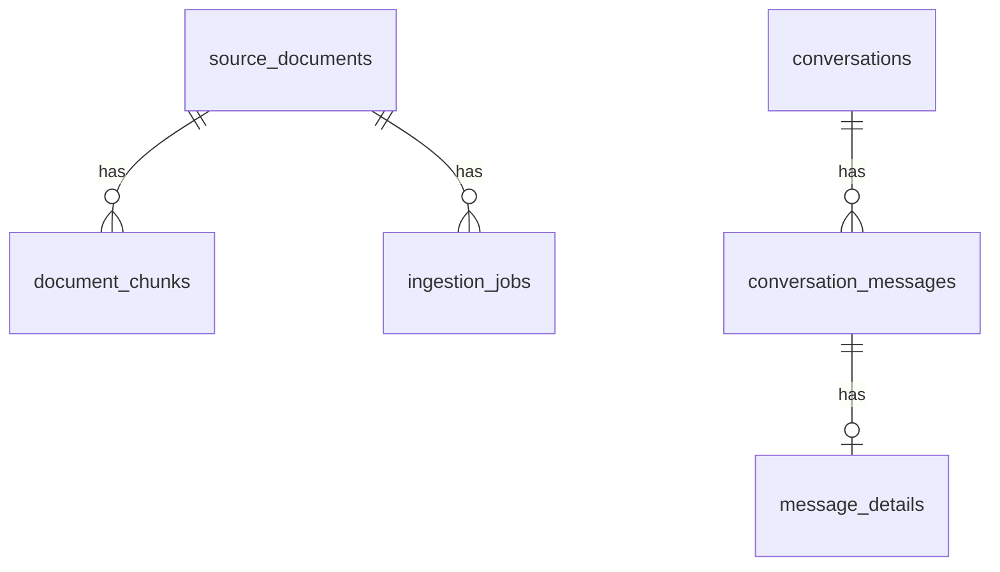
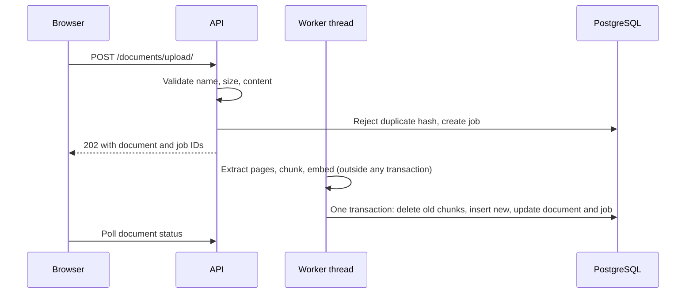
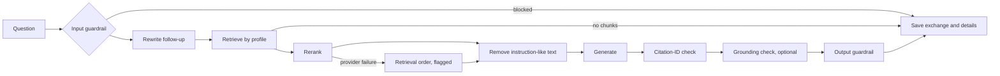

# Architecture

## Why uploads have their own tables

`public.documents` is the benchmark corpus. Its IDs 1-18 are referenced by the golden dataset, and `rag_user` does not own the table. So:

- Migration `001_platform.sql` adds `source_documents`, `document_chunks`, `ingestion_jobs`, `message_details` and `app_settings`, and changes nothing that exists.
- On first run, the baseline chunks are **copied** into `document_chunks` with the same IDs, under a protected document that cannot be deleted, replaced or re-indexed.
- Uploaded chunks start at ID 100000, so they cannot collide with golden IDs.
- `backend/replay_golden_retrieval.py` checks the result: 117 of 117 benchmark rank lists matched exactly, with no API calls.

## Ingestion

- **Failure safety:** slow work happens before the transaction. A failure leaves the old version searchable and records a reason.
- **Replacement:** the same filename with new content creates the next version. Identical content is rejected as a duplicate.
- **Restart:** unfinished jobs are marked failed at startup and can be retried. This assumes one worker process.
- **Chunk text:** `chunking.py` measures with the tokenizer but returns the original text. The older `rag_chat.chunk_text` rebuilds text from an uncased tokenizer, which lowercases it, so uploads do not use it.

## Answering a question

Faithfulness, citation-ID validity and citation support stay separate. The runtime checks citation IDs and runs the grounding judge. Claim-level citation support exists only in the offline evaluation.

Citations are saved as snapshots, so an answer keeps its evidence after its document is deleted.

## Retrieval profiles

Defined in `backend/config.py` and selectable per question, in Settings, or with `RAG_RETRIEVAL_PROFILE`.

| Profile | Method | Reranked depth | Evidence |
|---|---|---|---|
| `rrf3_1_top10` (current default) | RRF 3:1, 18 candidates per source | 10 | Reranking benchmark only |
| `A_vector_top10` | Vector | 10 | Generation evaluation A |
| `B_vector_top18` | Vector | 18 | Generation evaluation B |
| `C_rrf1_1_top18` | RRF 1:1 | 18 | Retrieval benchmark only |
| `D_rrf3_1_top18` | RRF 3:1 | 18 | Generation evaluation C |

## Configuration

All configuration is in environment variables, listed in `.env.example`. Validated runtime settings live in `app_settings`.

## Known limitations

See `FINAL_PROJECT_COMPLETION_REPORT.md`, section 20.
