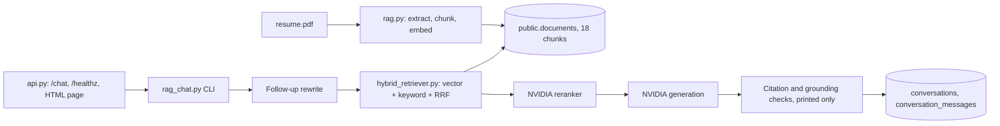

# Existing Architecture (before the platform work)

This describes the system as the Stage 0 audit found it. The current system is in `ARCHITECTURE.md`.

- **Ingestion:** `rag.py --ingest` appends rows. There are no document records, so running it twice duplicates chunks.
- **Evaluation:** separate scripts (`evaluate_golden_v1*.py`, `golden_v1_rrf_top18_benchmark.py`, `diagnose_golden_v1_citation_quality.py`, `apply_golden_v1_phase9_citation_corrections.py`) with checkpoints and JSON or Markdown reports.
- **Golden dataset:** `golden_dataset_v1.json` (original) and `golden_dataset_v1_reviewed.json` (approved).
